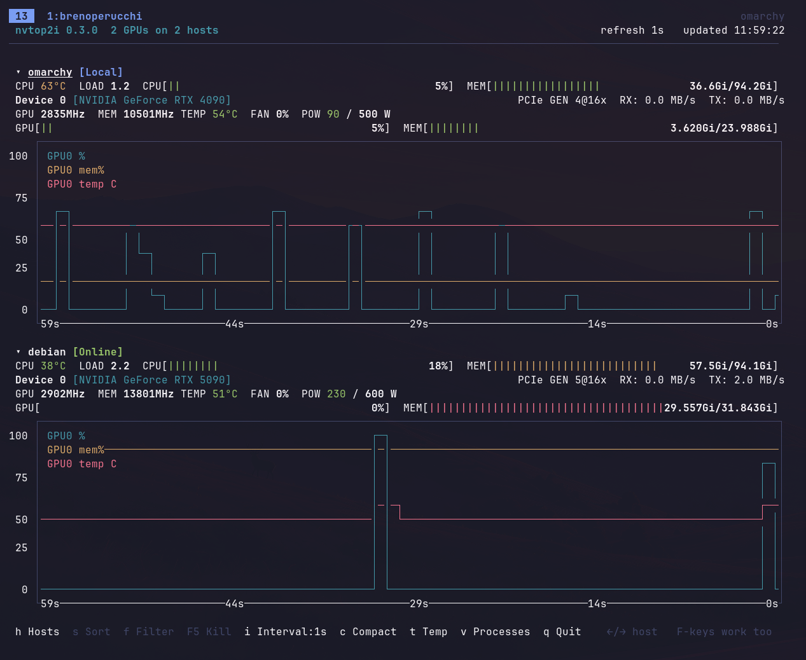

# nvtop2i

A terminal GPU monitor in the style of [nvtop](https://github.com/Syllo/nvtop). It shows the GPUs of your own machine and of any hosts you can reach over SSH, all on one screen.



Each GPU has the usual nvtop header: clocks, temperature, fan, power, PCIe link and throughput, plus utilization and memory bars. Under it sits a chart of the last 60 seconds of GPU use, memory use and temperature. Each host also gets one line with its CPU temperature, load, CPU use and memory. A second view lists the GPU processes of every host.

## Install

You need Python 3 (developed on 3.13) and [uv](https://docs.astral.sh/uv/) or pip.

```
uv tool install git+https://github.com/brenoperucchi/nvtop2i
```

With pip:

```
pip install git+https://github.com/brenoperucchi/nvtop2i
```

To update with uv, run `uv tool upgrade nvtop2i`.

### Windows

`windows-curses` is installed automatically. If the `nvtop2i` command is not found, the Scripts folder is not on your `PATH`; run `py -m nvtop2i` instead. The local GPUs are read with `nvidia-smi`. With the Windows (WDDM) driver the process list is empty and PCIe throughput shows `--`.

## Quick start

1. Run the setup once. It asks about each host and saves the answers:

   ```
   nvtop2i --setup
   ```

2. From then on, start the monitor with:

   ```
   nvtop2i
   ```

The local GPUs are always shown, so the monitor works without any config if you only have one machine. If you start it with no config in a terminal, it offers to run the setup.

### What the setup asks

For every host it asks for a name, an address, a user, an SSH port, a private key and an optional jump host. It then connects and tells you how many GPUs it found. You can also import hosts from your `~/.ssh/config` and pick the ones you want.

If the host rejects your key, the setup can copy your public key to it using your password once. The password is never written to disk. If you have no key yet, the setup can create an ed25519 one.

### Requirements on each host

- SSH login without a password prompt (a key or an agent).
- `nvidia-smi` in the `PATH` of a non-interactive `bash` for NVIDIA GPUs. AMD GPUs need nothing extra, only the `amdgpu` driver.

## Config file

The setup writes `~/.config/nvtop2i/config.ini`, readable only by you. It holds no passwords, only the path to your key. You can edit it by hand:

```ini
[general]
refresh = 2
show_cpu = yes
chart_temp = yes

[host lab]
hostname = 10.0.0.5
user = me
port = 22
identity_file = ~/.ssh/id_ed25519
proxy_jump = bastion
```

| Setting | Meaning |
|---|---|
| `refresh` | Seconds between updates, at least 1 (default 2) |
| `show_cpu` | `yes` or `no`: the CPU and memory line under each host (default yes) |
| `chart_temp` | `yes` or `no`: the temperature line in the charts (default yes) |
| `hostname` | Address of the host (default: the section name) |
| `user` | SSH user (default: your current user) |
| `port` | SSH port (default 22) |
| `identity_file` | Private key to use (optional) |
| `proxy_jump` | Another configured host to connect through (optional) |

The file lives in `$XDG_CONFIG_HOME/nvtop2i/` when that variable is set. Set `NVTOP2I_CONFIG` to use a file somewhere else.

## Command line

```
nvtop2i                          # local GPUs plus the hosts in the config file
nvtop2i --setup                  # run the setup again to add or change hosts
nvtop2i -r 5                     # refresh every 5 seconds, overriding the config
nvtop2i --ssh-config ./gpu_hosts # read hosts from an SSH config file instead
nvtop2i --version
```

With `--ssh-config`, every `Host` entry of that file is polled, so a file that lists only the machines with GPUs works best. `ProxyJump` and `ProxyCommand` are supported there.

Each host has its own thread and keeps one SSH connection open, so a slow or dead host only affects its own rows. After a failure the connection is retried with a growing delay. A host that has not answered for three refresh intervals (at least 10 seconds) is marked with the time since its last update.

## Keys

Every action has a letter, because desktops often keep the function keys for themselves. The function keys work too when your terminal receives them.

| Key | Action |
|---|---|
| `←` `→` | select a host |
| `↑` `↓` | select a process (process view) |
| `v`, `Tab` or `F9` | switch between the charts (default) and the process table |
| `h` or `F2` | fold or unfold the selected host |
| `t` | show or hide the temperature line in the charts |
| `c` or `F8` | compact view, one line per GPU |
| `i` or `F6` | next refresh interval: 1, 2, 5, 10 or 30 seconds |
| `s` or `F3` | cycle the process sort: memory, GPU %, PID, user, host (process view) |
| `f`, `/` or `F4` | filter processes by host, user or command; Enter applies, Esc clears (process view) |
| `r` | refresh now |
| `q`, `Esc` or `F10` | quit |

The view switches to compact on its own when the terminal is narrower than 100 columns or too short for the full layout. `F5 Kill` is shown greyed out; killing processes is not implemented.

Bars are green below 50 %, yellow up to 80 % and red above. Temperature is green below 60 °C, yellow up to 80 °C and red above.

## Notes

- Under each host, one line shows CPU use, CPU temperature, load and memory. It is read from `/proc` and the hwmon sensors, so it needs a Linux host; it is left out on Windows and in the compact view. CPU use is measured between two refreshes, so it shows `--` right after start.
- The local machine is listed under its own hostname.
- Connection drops, failed attempts, reconnections and GPU faults are written to `~/.local/state/nvtop2i/nvtop2i.log` (set `NVTOP2I_LOG` to move it). A host row shows the attempt number and the time left until the next try.
- When the driver loses a card, the block shows `! GPU requires reset` (red) or `! no reading from driver` (yellow) instead of a row of `--`, and the load bar shows `--` instead of `0%`. The log gets one line when the fault starts and one when it clears. A plain `[N/A]` (WSL) is not a fault.
- PCIe throughput comes from `nvidia-smi dmon` and is reported in MB/s.
- On Windows hosts that run `nvidia-smi` inside WSL, the process list is usually empty and fan, power or PCIe values may show as `--`.
- Windows hosts whose OpenSSH default shell is `cmd.exe` work because the probe script is sent base64-encoded instead of single-quoted.
- AMD GPUs (amdgpu) are read from `/sys/class/drm` with no extra tools: usage, VRAM, temperature, fan, power, clocks and PCIe. The name comes from `lspci`, so some cards show the whole family (for example `RX 470/480/570/580/590`). The process list is not available for AMD yet.
- MetaX (`mx-smi`) and Google Cloud TPU hosts are detected and shown with the one-line layout, without clocks, fan or PCIe fields.
- Hosts under `*.nci.org.au` are treated as Gadi login nodes, and the GPU compute nodes allocated to your jobs are discovered every minute.

## Development

```
uv run python -m pytest
```

The layout code builds plain lines of text, so most of the interface is tested without a terminal.

## Credits and license

nvtop2i started from [gnvitop](https://github.com/Linwei94/gnvitop) by Linwei94 (MIT). The SSH config parsing, the MetaX and TPU probes and the Gadi node discovery still come from that code. The terminal interface, the monitor, the setup and the tests are new. The first commit imports gnvitop 0.5.0 as it was; its earlier history is in that repository.

The layout follows nvtop's look. No code was taken from nvtop, which is GPL-3.0.

MIT, see [LICENSE](LICENSE).
